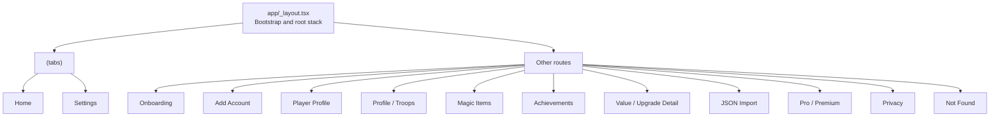

# Clash One UI Audit — Source Review

**Target branch:** `ui/full-app-redesign`  
**Repository:** [0053ishav/ClashOneApp](https://github.com/0053ishav/ClashOneApp/tree/ui/full-app-redesign)  
**Review type:** Source-level UI and architecture audit  
**Status:** Initial audit; runtime screenshots, device interaction, and accessibility checks remain outstanding.

## Scope and guardrails

This review examines route structure, screen/component responsibilities, styling consistency, interaction semantics visible in source, and boundaries to preserve during a UI redesign.

The preferred visual direction uses the existing JSON import screen's active colors as a **palette reference only**: deep background `#0A0F1A`, navy surface `#121A2B`, slate surface `#172033`, border `#222D44`, primary text `#F1F5F9`, secondary text `#94A3B8`, and gold accent `#FBBF24`. Do not use `JsonImportScreenLayout` as a layout or component benchmark.

No source files have been modified as part of this audit.

## 1. Route map

Primary route files:
- [Root layout](../app/_layout.tsx)
- [Tabs layout](../app/(tabs)/_layout.tsx)
- [Home](../app/(tabs)/index.tsx)
- [Settings](../app/(tabs)/settings.tsx)
- [Onboarding](../app/onboarding.tsx)
- [Add Account](../app/add-account.tsx)
- [Profile](../app/profile.tsx)
- [Troops](../app/profile/troops.tsx)
- [Magic Items](../app/magic-items.tsx)
- [Achievements](../app/achievements.tsx)
- [Value](../app/value.tsx)
- [JSON import](../app/upload-json.tsx)
- [Pro](../app/pro.tsx)
- [Privacy](../app/privacy.tsx)

## 2. Findings

### P1 — Accessibility semantics are uneven across interactive screens

Source inspection found many pressable controls without explicit `accessibilityLabel` and/or `accessibilityRole` in several routes. The source-level counts below are a screening signal, not proof that every control is inaccessible; wrappers or visible text can provide some semantics, and runtime verification is still needed.

| Screen | Approx. source lines | `accessibilityLabel` occurrences | `accessibilityRole` occurrences |
|---|---:|---:|---:|
| Home | 2,675 | 7 | 7 |
| Settings | 1,753 | 11 | 7 |
| Profile / Troops | 854 | 2 | 7 |
| Achievements | 717 | 0 | 2 |
| Value | 1,037 | 0 | 0 |
| Onboarding | 469 | 0 | 0 |
| Pro | 441 | 0 | 0 |
| Magic Items | 357 | 4 | 4 |

**Recommendation:** During redesign, every icon-only action must have a clear label; interactive controls need appropriate roles, selected/disabled state, and meaningful screen-reader order. Test with TalkBack on Android, not only by counting source attributes.

Evidence: [Home](../app/(tabs)/index.tsx), [Settings](../app/(tabs)/settings.tsx), [Achievements](../app/achievements.tsx), [Value](../app/value.tsx), [Onboarding](../app/onboarding.tsx), [Pro](../app/pro.tsx).

### P1 — Home and Settings combine substantial UI surface with application behavior

Home is about 2,675 lines and Settings about 1,753 lines. They import and coordinate many feature components and services. This size alone is not a defect, but it increases the cost and regression risk of changing layout, state, and interactions in one pass.

**Recommendation:** Do not rewrite either screen wholesale. Identify existing presentational sections and extract only where it creates a stable responsibility boundary. Keep data loading, event handling, and domain mutations in their current hooks/services unless a specific defect justifies a change. Start with a visual-only change to one representative section, then verify before propagating the pattern.

Evidence: [Home](../app/(tabs)/index.tsx), [Settings](../app/(tabs)/settings.tsx).

### P1 — Styling decisions are repeated in screen-level StyleSheets

The inspected routes define their own `StyleSheet.create` objects and repeat hex colors. Examples include Home, Settings, onboarding, Profile, Magic Items, Achievements, Value, Pro, and the tab shell. Some feature colors are meaningful and should remain semantic rather than be flattened into a generic accent.

**Recommendation:** Introduce typed shared tokens with explicit roles, for example:
- `background`, `surface`, `surfaceRaised`, `border`
- `textPrimary`, `textSecondary`, `textMuted`
- `accent` (gold), `success`, `warning`, `danger`
- semantic village/category colors for Home Village and Builder Base
- spacing, radii, typography sizes, and touch target sizes

Use the JSON import screen's palette as a starting reference only. Do not copy its layout or blindly replace every local color. Migrate in small batches and preserve status meaning and contrast.

Evidence: [Tab shell](../app/(tabs)/_layout.tsx), [Profile](../app/profile.tsx), [Magic Items](../app/magic-items.tsx), [Achievements](../app/achievements.tsx), [Pro](../app/pro.tsx).

### P2 — Large detail screens need a consistent information hierarchy

The Profile/Troops screen (854 lines), Achievements (717 lines), and Value (1,037 lines) are large enough that visual consistency and scanability should be assessed at section level. Source alone cannot establish whether the rendered screens are crowded, but it does identify a high-impact review surface.

**Recommendation:** Define a shared screen grammar:
1. safe-area-aware page shell and clear title/back action;
2. one dominant summary or task area;
3. consistent section heading and spacing;
4. reusable cards/rows for repeated data;
5. stable empty, loading, error, and disabled states;
6. one consistent button hierarchy.

Avoid turning every data group into a visually equal card. Prioritize the user's next action and keep detailed game stats secondary to progression tasks where appropriate.

Evidence: [Profile/Troops](../app/profile/troops.tsx), [Achievements](../app/achievements.tsx), [Value](../app/value.tsx).

### P2 — Navigation and screen-shell consistency need runtime review

The tab layout owns custom colors, dimensions, animation, keyboard handling, safe-area behavior, and advertising integration. The root layout owns substantial app initialization and also contains presentation styles. This makes shell changes particularly sensitive.

**Recommendation:** Treat the root stack and tab shell as separate responsibilities. Keep tab navigation, keyboard behavior, safe-area insets, and ad placement intact while adjusting appearance. Verify small Android devices, gesture navigation, keyboard-open states, and screens with long scrolling content.

Evidence: [Tab shell](../app/(tabs)/_layout.tsx), [Root layout](../app/_layout.tsx).

### P2 — Feature-specific colors and status cues need semantic rules

Magic Items uses multiple item/category colors, while Profile and the tab shell have their own accents. These differences may represent meaningful game concepts rather than inconsistency.

**Recommendation:** Create a semantic mapping before refactoring colors. Document which colors mean navigation focus, village type, upgrade status, inventory category, warning, success, or premium status. Never use color as the only way to communicate state; pair it with text or icons.

Evidence: [Magic Items](../app/magic-items.tsx), [Profile](../app/profile.tsx), [Tab shell](../app/(tabs)/_layout.tsx).

## 3. Functional boundaries to protect

The UI redesign should preserve the existing domain and integration boundaries:

- **Account state and persistence:** account switching, profiles, import snapshots, widget preferences, and SQLite state.
- **Progression engine:** upgrade and progression calculations should not move into visual components.
- **JSON import:** preserve validation, imported timing reconstruction, account synchronization, and widget refresh behavior.
- **Notifications and widgets:** maintain scheduling, event emission, cache refresh, and completion behavior.
- **Purchases:** preserve RevenueCat purchase/restore flows and premium state synchronization.
- **Clash API:** use only data actually exposed by the official [Clash of Clans API](https://developer.clashofclans.com/). Do not infer that it provides all client-side timers or imported progression details.

Relevant source: [Account store](../stores/accountStore.ts), [JSON import service](../services/jsonImport/jsonImportService.ts), [Database](../db/database.ts), [Clash API service](../services/clashApi.ts), [Root layout](../app/_layout.tsx).

## 4. Recommended audit and implementation sequence

1. **Baseline:** capture the running Android screens and main interaction states; note current behavior before changing UI.
2. **Design tokens:** define color roles, spacing, typography, radius, elevation, and touch targets.
3. **Shared primitives:** establish page shell, section heading, card/surface, primary/secondary button, icon action, and empty/loading/error patterns.
4. **Home:** redesign one section at a time, beginning with the account/progression summary and active-upgrade list.
5. **Settings and account flows:** apply shared patterns without altering account-management behavior.
6. **Progression detail screens:** Profile, Troops, Value, Achievements, and Magic Items.
7. **Onboarding, JSON import, Pro, and utility screens:** align their shell and interaction states while retaining their existing workflows.
8. **Verification:** type-check, lint, run tests, and perform Android smoke tests for account switching, import, progression updates, widget refresh, notifications, and purchase/restore.

## 5. Evidence limits and next checks

This is a **source-level audit**, not a completed screenshot-based UX audit. No Android runtime screenshots were captured in this pass, and visual density, actual contrast, touch target size, keyboard overlap, scroll behavior, and TalkBack announcements have not been verified on a device.

Before claiming the UI audit complete, capture the actual app in a running Android environment for at least:
- Home with an active upgrade and with no active upgrade;
- account switch/add account;
- Settings;
- Profile and a detail screen;
- Magic Items;
- JSON import, including validation/error state;
- onboarding;
- Pro/purchase screen.

Then tie visual findings to the screenshots and test the interaction/accessibility risks listed above.

## Source references

- [Clash One repository](https://github.com/0053ishav/ClashOneApp/tree/ui/full-app-redesign)
- [Expo Router](https://docs.expo.dev/router/introduction/)
- [React Native accessibility](https://reactnative.dev/docs/accessibility)
- [Official Clash of Clans API](https://developer.clashofclans.com/)
