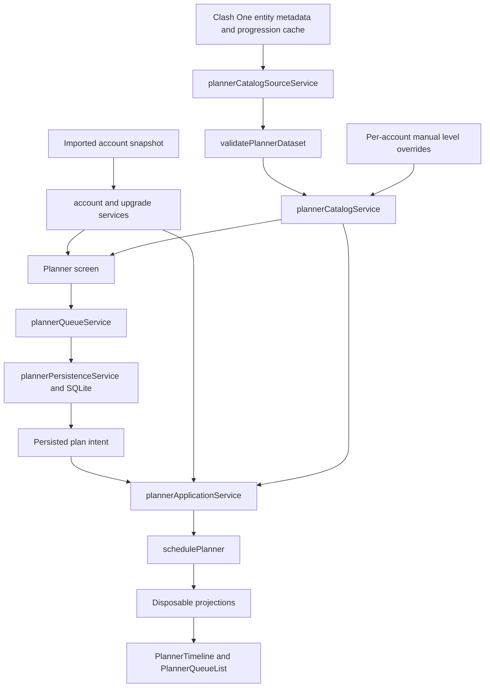

# Upgrade Planner architecture

## Boundaries

## Modules and ownership

| Responsibility | Current owner |
|---|---|
| Adapt cached entity/progression records | `services/plannerCatalogSourceService.ts` |
| Validate external/cached progression records and produce diagnostics | `utils/planner/validatePlannerDataset.ts` |
| Filter and build the next-upgrade catalog | `services/plannerCatalogService.ts` |
| Resolve imported levels over saved manual overrides and enumerate editable entities | `services/plannerCatalogLevelState.ts` |
| Persist per-account manual levels | `services/plannerCatalogLevelStorage.ts` |
| Persist queue, plans, and reviewed snapshot metadata | `services/plannerPersistenceService.ts` |
| Apply pure queue edits and ordering | `services/planner/plannerQueueService.ts` |
| Build disposable schedule output from persisted intent | `services/plannerApplicationService.ts` |
| Calculate lane placement and schedule states | `utils/planner/schedulePlanner.ts` |
| Present catalog, queue, and timeline interactions | `app/(tabs)/planner.tsx` and `components/planner/` |
| Reconcile imported structure copies | `services/planner/structureInstanceService.ts` and related storage/service modules |

## Domain contracts

`types/planner.ts` separates progression candidates, observed live timers, planned queue items, plans, and schedule projections. Estimates and projections use discriminated unions so unknown values are not encoded as zero and blocked work is not represented as a successful schedule. `PlannerPlan` and plan items are account-scoped. The plan village is Home Village.

The plan queue is durable user intent. Projections are recalculated and not persisted. Live timers continue to use the app's existing upgrade model and are passed to the scheduler only as occupancy evidence.

## Validation and error handling

Cached progression payloads are runtime-validated before catalog use. Missing category caches become unavailable rather than a valid empty category. Persistence validates account/plan ownership and lane shape when loading or writing. The UI catches load/save/projection errors at the relevant boundary and surfaces their message; a failed catalog load is not replaced with an empty result.

The account tag participates in plan queries, manual-level storage keys, and snapshot review. The planner request coordinator invalidates stale catalog requests when account/filter identity changes.

## Persistence

Plans and items are stored in SQLite and scoped by account player tag. Manual level overrides are stored separately per account in MMKV. Structure-instance IDs and confidence are stored separately from entity metadata. Plan snapshot timestamps allow the screen to request an explicit review after newer imports; acknowledging a snapshot does not rewrite queue intent.

Any serialized type change must be checked against the existing database schema/migrations and old plan loading behavior. The current slice did not change persisted shapes.

## Dependency direction

Catalog adaptation and validation feed pure catalog construction. The screen coordinates account state, async services, and interactions. Pure queue mutations and scheduling do not import React or perform persistence/network I/O. UI components render prepared projections and do not implement a second scheduler.
